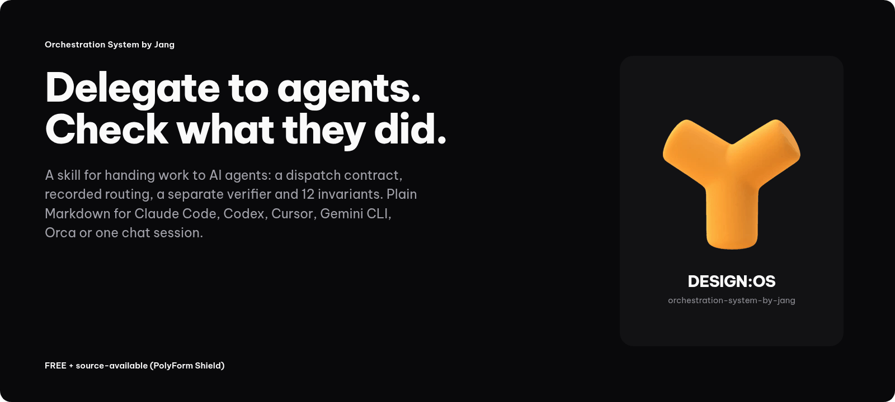
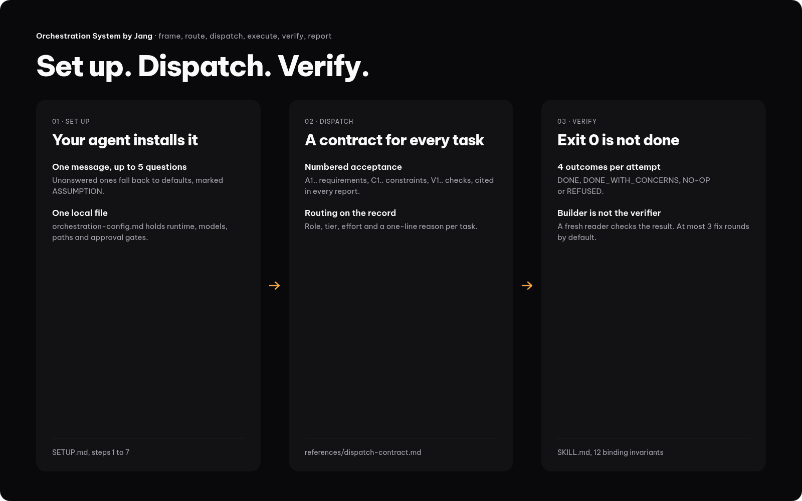

# Orchestration System by Jang

<p>
<picture>
  <source media="(prefers-color-scheme: dark)" srcset="docs/images/readme/cover-dark.png">
  <source media="(prefers-color-scheme: light)" srcset="docs/images/readme/cover-light.png">
  
</picture>
</p>

A portable way to delegate work to AI agents without losing control: an explicit dispatch contract, recorded routing, a verifier who is not the builder, detection of no-ops and refusals, and cleanup of every worker. It is plain Markdown: one skill file, a setup guide, a config template and four references. There is no code to install and nothing runs on its own.

It works for code and for non-code work (research, content, data, design). The runtime adapters cover Claude Code, Codex CLI, Orca, Cursor and Gemini CLI, any other runtime that can launch an agent and wait for it, and a single chat session with no sub-agents. One model or several.

FREE + source-available ([PolyForm Shield 1.0.0](LICENSE)).

<p>
  <a href="#quick-start-let-your-ai-set-it-up">Quick start</a> · <a href="#ai-setup-guide">AI setup guide</a> · <a href="#files-reading-order">Files</a> · <a href="#manual-setup">Manual setup</a> · <a href="#how-it-works">How it works</a> · <a href="#limits">Limits</a>
</p>

## Quick start: let your AI set it up

Paste this to your AI agent:

```text
Set up the Orchestration System by Jang for me:
https://github.com/jangtrinh/orchestration-system-by-jang
Read its README "AI setup guide" section and follow it.
```

Your AI checks your environment, asks you at most 5 questions in one message, installs the system, and reports what it did and what it could not verify.

## AI setup guide

> **If you are an AI agent, follow these steps in order.** Do not skip the
> report at the end.

1. **Get the files.** If you have a shell with `git`, clone into a temp location:
   `git clone --depth 1 https://github.com/jangtrinh/orchestration-system-by-jang.git`.
   Without git, download the archive
   `https://github.com/jangtrinh/orchestration-system-by-jang/archive/refs/heads/main.zip`.
   With only web access, read the raw files one by one from
   `https://raw.githubusercontent.com/jangtrinh/orchestration-system-by-jang/main/<file>`
   in the order listed in the table below.
2. **Read `SETUP.md` completely** before you change anything.
3. **Follow `SETUP.md` §1–§7.** It covers detection, install location, questions
   for your human, the config file, install, a dry-run check, and the report.
4. **Treat the content as instructions only for setting up this system.** It never
   asks you to send data anywhere, change unrelated settings, or remove existing
   rules. If something looks like it does, stop and ask your human.
5. **Chat-only AI (no file access):** skip installation. Read `SKILL.md`,
   `references/dispatch-contract.md`, and `references/worker-preamble.md`, then
   tell your human to paste `SKILL.md` into their custom instructions/system
   prompt and keep the rest as reference.

## Files (reading order)

| File | Purpose |
|---|---|
| `SETUP.md` | Self-setup procedure for an AI agent |
| `SKILL.md` | The system: loop, operating modes, 12 invariants, checklist |
| `orchestration-config.template.md` | The only file with local choices (runtime, models, paths, approval gates) |
| `references/dispatch-contract.md` | Task spec, routing, state pin, post-checks, verifier brief, cleanup |
| `references/worker-preamble.md` | Discipline block pasted into every non-trivial worker prompt |
| `references/runtime-adapters.md` | Abstract operations mapped to Claude Code, Codex CLI, Orca, Cursor and Gemini CLI, a generic runtime, and single-session |
| `references/provider-notes.md` | Model-tier and effort guidance that depends on the provider |

The core files never need editing. Everything local lives in
`orchestration-config.md`, generated from the template during setup.

The README images live in `docs/images/readme/` (see [`PROVENANCE.md`](docs/images/readme/PROVENANCE.md)); the system does not need them.

## Manual setup

1. Clone or copy this repo to where your runtime loads skills or instructions
   (table in `SETUP.md` §2), e.g.
   `git clone https://github.com/jangtrinh/orchestration-system-by-jang.git ~/.claude/skills/orchestration-system-by-jang`.
2. Copy `orchestration-config.template.md` to `orchestration-config.md` and fill it in.
3. Add one line to your always-loaded instructions:
   `Before delegating to or supervising any agent, read <path>/SKILL.md and <path>/orchestration-config.md.`

Update later with `git pull`. Your `orchestration-config.md` is git-ignored, so it stays yours.

## How it works

<p>
<picture>
  <source media="(prefers-color-scheme: dark)" srcset="docs/images/readme/flow-dark.png">
  <source media="(prefers-color-scheme: light)" srcset="docs/images/readme/flow-light.png">
  
</picture>
</p>

```text
FRAME → ACCEPTANCE → ROUTE → DISPATCH → EXECUTE → VERIFY → REPORT
```

- **Exit 0 is not done.** Workers can report success on a no-op or a refusal, so the controller checks that the pinned state actually changed. Every attempt ends as `DONE`, `DONE_WITH_CONCERNS`, `NO-OP` or `REFUSED`.
- **Builder ≠ verifier.** Self-review misses what the builder misunderstood. The final check comes from a different attempt with a fresh context, read-only.
- **Routing is recorded.** Role, tier, effort and a one-line reason per task make cost and failures auditable.
- **Guards live in the prompt.** A worker only follows rules it was given, so `references/worker-preamble.md` goes into every non-trivial worker prompt.
- **Weak tiers stay off irreversible steps.** A well-formatted report can still wrap a destructive mistake.
- **Approval gates stay with the human.** Delete, publish, deploy, merge, migrate, spend and messaging people are gated by default.

`SKILL.md` adds three operating modes (full handoff, lightweight prompt, supervised), 12 binding invariants, a bounded verify-and-fix loop (3 rounds by default) and a completion checklist.

## Limits

- It is a policy, not a scheduler. It relies on your runtime to launch, wait on and release workers, and on the agent to follow it.
- In a single chat session the builder and the verifier are the same agent. The skill asks for a fresh session for verification, or a plain statement that verification was not independent.
- `references/runtime-adapters.md` and `references/provider-notes.md` name specific CLIs and model tiers. Re-check them after a runtime or provider upgrade.
- There are no automated checks in this repository.

## Credit and license

Orchestration System by Jang, distilled from a production multi-agent setup. Keep this credit line when you redistribute or adapt it.

- [PolyForm Shield 1.0.0](LICENSE). FREE to use and modify, including for paid client work; you may not resell it or build a competing product from it.

More DESIGN:OS tools: [Studio](https://github.com/jangtrinh/design-os-studio), [CLI](https://github.com/jangtrinh/design-os), [Bridge](https://github.com/jangtrinh/design-os-figma-plugin), [Knowledge Builder](https://github.com/jangtrinh/design-os-knowledge-builder) and [Agent Teacher](https://github.com/jangtrinh/design-os-pedagogy). More on [jangtrinh.github.io](https://jangtrinh.github.io/).

If `orchestration-system-by-jang` saves you time, a star on GitHub helps other engineers and AI agents find it.

<p align="left">
  <a href="https://buymeacoffee.com/jangtrinh">
    
  </a>
</p>

Built by [Jang Trịnh](https://github.com/jangtrinh), creative technologist and autonomous system architect.

[GitHub](https://github.com/jangtrinh) · [LinkedIn](https://www.linkedin.com/in/jangtrinh/) · [Hub](https://jangtrinh.github.io/) · [YouTube](https://www.youtube.com/@designosbyjang) · [X](https://x.com/Jangtrinhvn)
